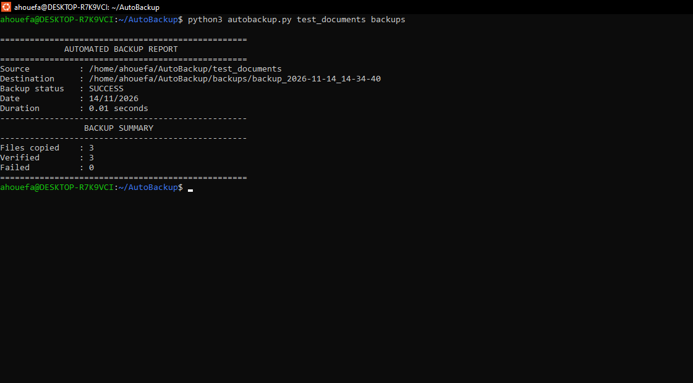
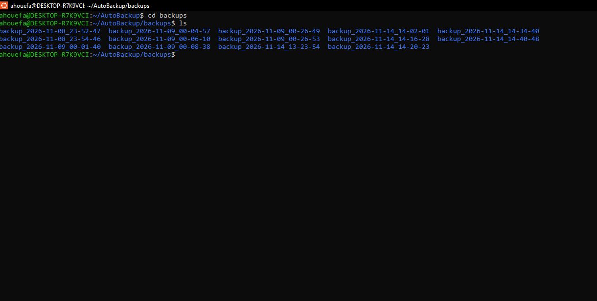
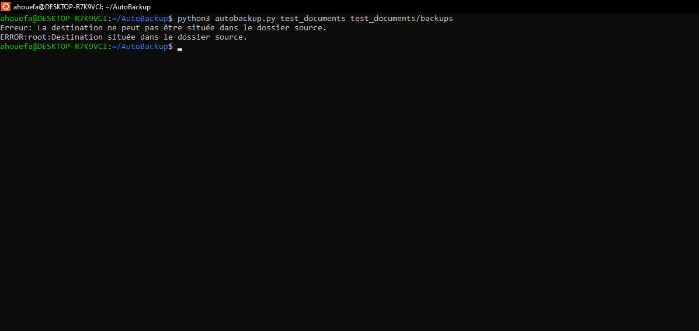

# AutoBackup

## Présentation
AutoBackup est un outil de sauvegarde automatisée développé en Python. Il permet de copier récursivement des fichiers et des dossiers vers une destination définie par l’utilisateur.

Chaque sauvegarde est enregistrée dans un dossier horodaté afin de conserver les différentes versions. Le programme vérifie ensuite l’intégrité des fichiers copiés à l’aide de l’algorithme SHA-256.

L’outil permet également de simuler une sauvegarde grâce à une option Dry-run, sans effectuer de copie réelle.

Ce projet a été réalisé dans le cadre de mon apprentissage de Python et de l’automatisation des tâches système.

# Démonstration

### Rapport de sauvegarde


### Structure de la sauvegarde


### Protection des chemins


## Fonctionnalités

* Vérification de l’existence et de la validité du dossier source.
* Configuration personnalisée des chemins source et destination.
* Création automatique du répertoire de destination.
* Protection contre une destination située à l’intérieur du dossier source.
* Copie récursive des fichiers et sous-dossiers.
* Création de sauvegardes horodatées.
* Vérification de l’intégrité des fichiers avec SHA-256.
* Gestion des erreurs et exceptions.
* Journalisation des opérations avec le module logging.
* Rapport récapitulatif dans le terminal.
* Mode simulation (Dry-run) permettant de visualiser les opérations prévues sans effectuer de copie.

## Technologies utilisées

* Python 3.12
* pathlib
* shutil
* datetime
* hashlib
* logging
* argparse
* time

Le projet utilise exclusivement la bibliothèque standard de Python. Aucune dépendance externe n’est nécessaire.


## Structure du projet
```
AutoBackup/
├── autobackup.py
├── test_documents/
│   ├── rapport.txt
│   ├── facture.txt
│   └── projets/
│       └── projet1.txt
├── backups/
├── logs/
├── .gitignore
└── README.md

```

Les dossiers backups/ et logs/ sont générés et utilisés lors de l’exécution du programme. Ils sont exclus du dépôt Git.

## Prérequis

* Python 3.12 ou une version compatible.
* Un environnement Linux ou un système disposant des fonctionnalités nécessaires à l’exécution du script.

## Installation et exécution

### 1. Cloner le dépôt :
```bash
git clone https://github.com/FrancescaYE/AutoBackup.git
```
### 2. Accéder au répertoire du projet :

```cd AutoBackup```

### 3. Afficher l'aide

``` python3 autobackup.py --help ```

### 4. Lancer une sauvegarde :

```python3 autobackup.py <source> <destination>```

### 5. Lancer une simulation

```python3 autobackup.py <source> <destination> --dry-run```

Exemple :

python3 autobackup.py test_documents backups
python3 autobackup.py test_documents backups --dry-run (pour la simulation)
Le programme crée automatiquement un sous-dossier horodaté dans le répertoire de destination.

### Rapport de sauvegarde

À la fin de chaque exécution, un rapport est affiché dans le terminal.

Il présente notamment :

* Le chemin du dossier source.
* Le chemin de la sauvegarde créée.
* Le statut de l’opération (SUCCESS ou FAILED).
* La date et la durée de l’exécution.
* Le nombre de fichiers copiés.
* Le nombre de fichiers vérifiés.
* Le nombre d’échecs.


### Mode simulation (Dry-run)

Le mode simulation permet d’afficher le dossier source et le chemin de destination prévu sans effectuer de copie.
ahouefa@DESKTOP-R7K9VCI:~/AutoBackup$ cat README.md
# AutoBackup

## Présentation
AutoBackup est un outil de sauvegarde automatisée développé en Python. Il permet de copier récursivement des fichiers et des dossiers vers une destination définie par l’utilisateur.

Chaque sauvegarde est enregistrée dans un dossier horodaté afin de conserver les différentes versions. Le programme vérifie ensuite l’intégrité des fichiers copiés à l’aide de l’algorithme SHA-256.

L’outil permet également de simuler une sauvegarde grâce à une option Dry-run, sans effectuer de copie réelle.

Ce projet a été réalisé dans le cadre de mon apprentissage de Python et de l’automatisation des tâches système.

# Démonstration

### Rapport de sauvegarde


### Structure de la sauvegarde


### Protection des chemins


## Fonctionnalités

* Vérification de l’existence et de la validité du dossier source.
* Configuration personnalisée des chemins source et destination.
* Création automatique du répertoire de destination.
* Protection contre une destination située à l’intérieur du dossier source.
* Copie récursive des fichiers et sous-dossiers.
* Création de sauvegardes horodatées.
* Vérification de l’intégrité des fichiers avec SHA-256.
* Gestion des erreurs et exceptions.
* Journalisation des opérations avec le module logging.
* Rapport récapitulatif dans le terminal.
* Mode simulation (Dry-run) permettant de visualiser les opérations prévues sans effectuer de copie.

## Technologies utilisées

* Python 3.12
* pathlib
* shutil
* datetime
* hashlib
* logging
* argparse
* time

Le projet utilise exclusivement la bibliothèque standard de Python. Aucune dépendance externe n’est nécessaire.


## Structure du projet
```
AutoBackup/
├── autobackup.py
├── test_documents/
│   ├── rapport.txt
│   ├── facture.txt
│   └── projets/
│       └── projet1.txt
├── backups/
├── logs/
├── .gitignore
└── README.md

```

Les dossiers backups/ et logs/ sont générés et utilisés lors de l’exécution du programme. Ils sont exclus du dépôt Git.

## Prérequis

* Python 3.12 ou une version compatible.
* Un environnement Linux ou un système disposant des fonctionnalités nécessaires à l’exécution du script.

## Installation et exécution

### 1. Cloner le dépôt :
```bash
git clone https://github.com/FrancescaYE/AutoBackup.git
```
### 2. Accéder au répertoire du projet :

```cd AutoBackup```

### 3. Afficher l'aide

``` python3 autobackup.py --help ```

### 4. Lancer une sauvegarde :

```python3 autobackup.py <source> <destination>```

### 5. Lancer une simulation

```python3 autobackup.py <source> <destination> --dry-run```

Exemple :

python3 autobackup.py test_documents backups
python3 autobackup.py test_documents backups --dry-run (pour la simulation)
Le programme crée automatiquement un sous-dossier horodaté dans le répertoire de destination.

### Rapport de sauvegarde

À la fin de chaque exécution, un rapport est affiché dans le terminal.

Il présente notamment :

* Le chemin du dossier source.
* Le chemin de la sauvegarde créée.
* Le statut de l’opération (SUCCESS ou FAILED).
* La date et la durée de l’exécution.
* Le nombre de fichiers copiés.
* Le nombre de fichiers vérifiés.
* Le nombre d’échecs.


### Mode simulation (Dry-run)

Le mode simulation permet d’afficher le dossier source et le chemin de destination prévu sans effectuer de copie.
Pour activer ce mode, ajouter l’option --dry-run à la commande d’exécution. Sans cette option, le programme effectue normalement la sauvegarde.


### Journalisation

Les opérations et les erreurs sont enregistrées dans le fichier :

logs/autobackup.log

Cette journalisation permet de conserver un historique des sauvegardes et de consulter les éventuelles erreurs.

### Objectifs pédagogiques

Ce projet m’a permis de mettre en pratique :

* La manipulation des fichiers et répertoires avec Python.
* L’automatisation de tâches système.
* La gestion des exceptions.
* La vérification de l’intégrité des données.
* La journalisation des opérations.
* L’organisation d’un projet Python.

### Journalisation

Les opérations et les erreurs sont enregistrées dans le fichier :

logs/autobackup.log

Cette journalisation permet de conserver un historique des sauvegardes et de consulter les éventuelles erreurs.

### Objectifs pédagogiques

Ce projet m’a permis de mettre en pratique :

* La manipulation des fichiers et répertoires avec Python.
* L’automatisation de tâches système.
* La gestion des exceptions.
* La vérification de l’intégrité des données.
* La journalisation des opérations.
* L’organisation d’un projet Python.

### Auteur

Francesca YETO
GitHub : [FrancescaYE](https://github.com/FrancescaYE)
